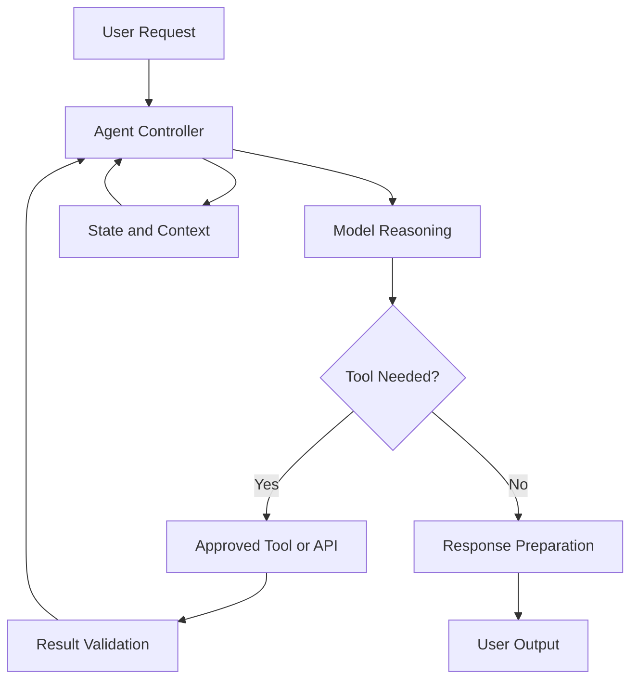

 

  

&nbsp;

&nbsp;

  

---

## 🧭 What Is AI Agent Framework?

**AI Agent Framework** is a project concept centered on building applications that can coordinate language models, tools, and multi-step workflows. Rather than treating AI as a single question-and-answer box, an agent-oriented approach breaks complex work into manageable actions: interpret a request, select a capability, process results, and prepare a useful response.

For developers, agent frameworks offer a structured way to explore **tool integration**, **task orchestration**, **state management**, and **human oversight**. These ideas can be applied to assistants for research, software development, knowledge retrieval, internal operations, and repetitive workflows.

> **The idea:** Give AI applications a clear workflow, explicit tools, and observable steps — not just a longer prompt.

## ✨ Why Developers Explore Agent Frameworks

| Advantage | Why it matters |
|:--|:--|
| 🧩 **Modular design** | Separate model interactions, tool calls, and application logic into understandable components. |
| 🔗 **Tool connectivity** | Design integrations with APIs, search services, databases, and internal systems. |
| 🔄 **Repeatable workflows** | Organize multi-step tasks into reusable sequences. |
| 🔍 **Visibility** | Make intermediate actions easier to inspect, test, and debug. |
| 🧠 **Context-aware interactions** | Explore how agents carry task context between steps. |
| 👥 **Human checkpoints** | Add approvals for actions that need review before execution. |

## 🏗️ Anatomy of an AI Agent

*Conceptual architecture: individual implementations may use different components or execution paths.*

## 🎯 What Can You Build?

<table>
<tr><td width="50%" valign="top">

### 💬 Intelligent Assistants

Build conversational experiences that can retrieve information, organize responses, and guide users through structured tasks.

</td><td width="50%" valign="top">

### 🛠️ Developer Helpers

Experiment with agents that explain code, summarize errors, and coordinate approved development tools.

</td></tr>
<tr><td valign="top">

### 📚 Knowledge Workflows

Explore document retrieval, summarization, and source-aware question answering.

</td><td valign="top">

### ⚙️ Task Automation

Prototype repeatable workflows with clear inputs, decision points, and review steps.

</td></tr>
</table>

## 🚀 Get the Project

Ready to explore agent-based application development? Use the project access button below.

### A Practical Starting Path

1. **Open the project page** using the button above and review the available files and setup information.
2. **Identify the workflow** you want your agent to handle, such as research assistance or internal knowledge lookup.
3. **Choose the integrations** needed for that workflow and define what each tool is allowed to do.
4. **Test a small scenario** before expanding into more complicated, multi-step behavior.

## 🧪 Agent Design Principles

| Principle | Practical approach |
|:--|:--|
| **Start narrow** | Define one task with a measurable result. |
| **Keep tools explicit** | Document each tool's purpose, inputs, and expected outputs. |
| **Validate results** | Check external data and tool responses before using them. |
| **Plan for failure** | Handle timeouts, missing information, and unsuccessful actions. |
| **Make actions reviewable** | Log meaningful steps and request approval where appropriate. |

## 💡 Project Ideas

- **Documentation assistant:** find relevant pages and assemble concise answers.
- **Issue triage helper:** categorize incoming reports and suggest next steps.
- **Research organizer:** collect source notes and produce structured summaries.
- **Workflow companion:** guide users through recurring, multi-stage processes.

## ❓ Frequently Asked Questions

<b>What is the difference between an AI chatbot and an AI agent?</b>

A chatbot primarily exchanges messages. An agent-oriented application may also select tools, track workflow state, and perform defined steps toward a goal.

<b>Do agent frameworks require a particular language model?</b>

Not inherently. Compatibility depends on the framework implementation, supported model interfaces, and provider requirements.

<b>Can I use an agent framework for automation?</b>

Agent patterns can support automation, particularly when tasks are broken into explicit steps with tool permissions, validation, and error handling.

<b>Where can I find the project?</b>

Use the **Open Project Page** button above to access the provided project link.

---

### Build More Than a Chatbot.

**Explore the patterns behind tool-using, workflow-driven AI applications.**

  

